# pi-robot — Modular Autonomous Robot Control System

A professional, node-based robot control framework for Raspberry Pi + ESP32.

<p align="center">
  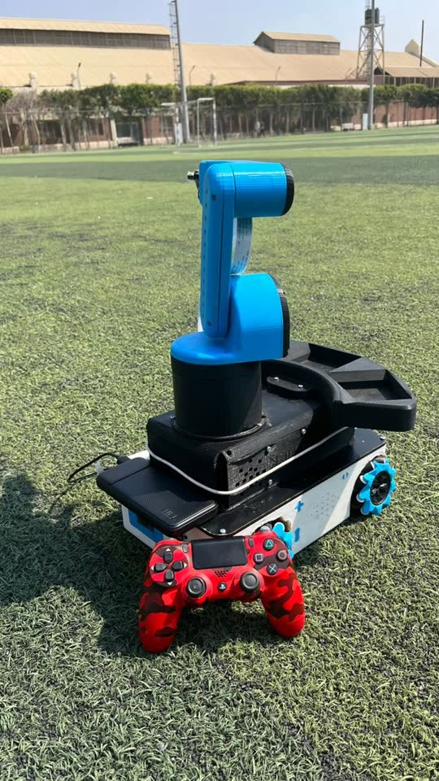
</p>

---

## Hardware and Electronics

The robot is a modular omni-wheel mobile manipulator: a four-motor mobile base
and a servo-driven arm, each on its own battery and its own ESP32-S3 board,
with a Raspberry Pi running the Python control stack in this repository. The
electrical design below comes from the project's PCB design and power-sizing
documents (Ain Shams University, Mechatronics, Spring 2026).

### Built hardware

Photos of the finished robot and its assembled control board.

| Assembled ESP32-S3 control board | Arm, side view | Arm, front view |
|---|---|---|
| 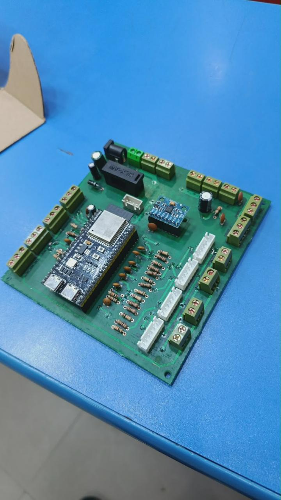 | 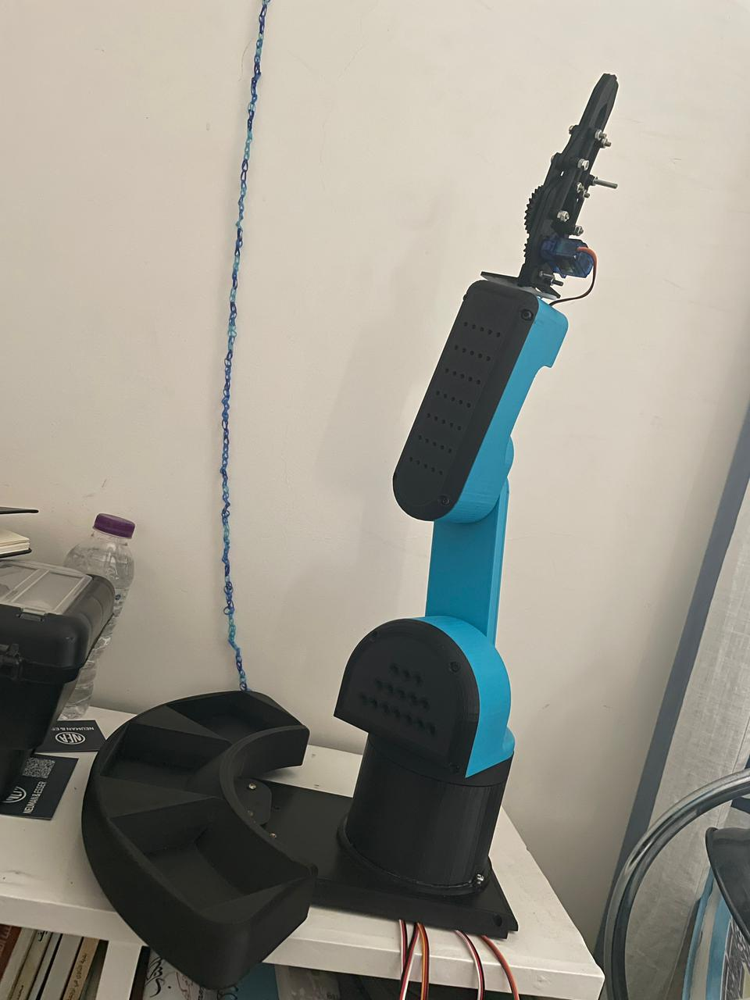 | 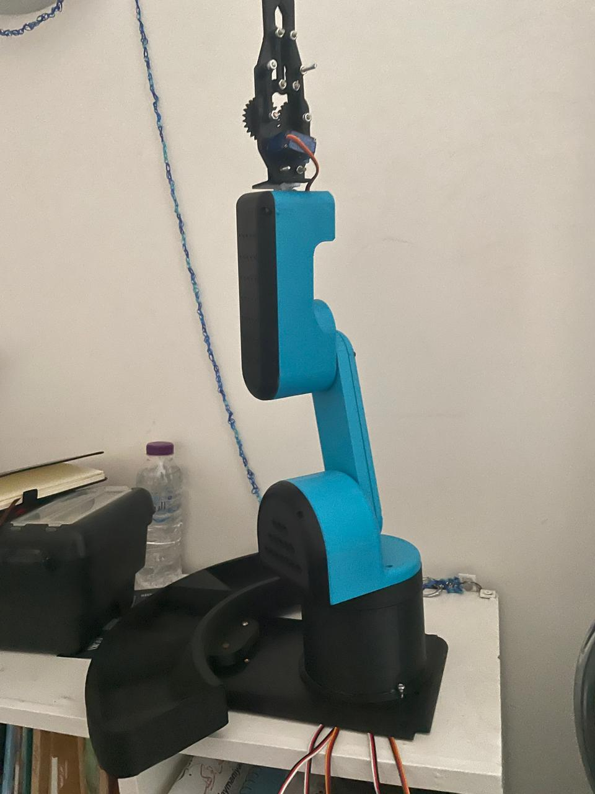 |

<p align="center">
  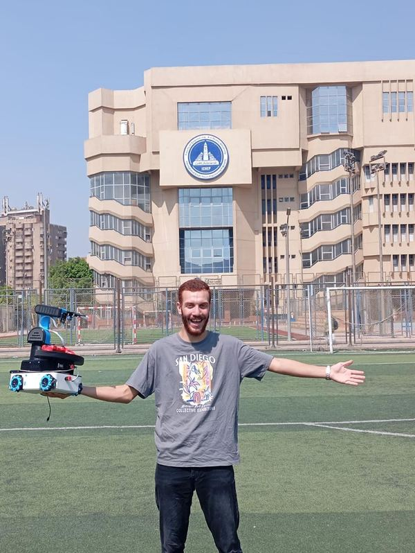
</p>

### CAD and PCB renders

CAD renders of the arm, gripper and full robot, and 3D renders of the two PCBs (these are renders, not photos).

| Isometric | Top (camera mount) | Side |
|---|---|---|
| 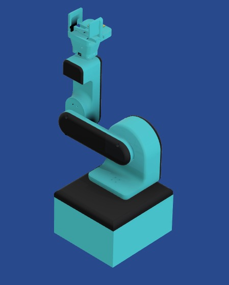 | 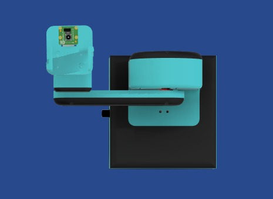 | 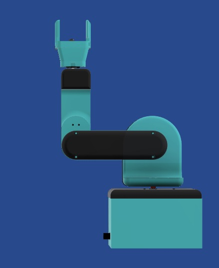 |

| Full robot | Gripper and camera mount | PCB (ESP32-S3, TB6612 drivers) | PCB (servo and power board) |
|---|---|---|---|
| 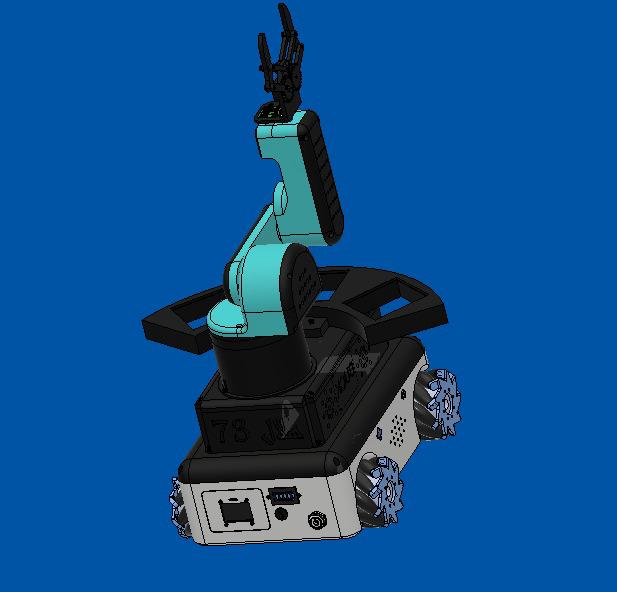 | 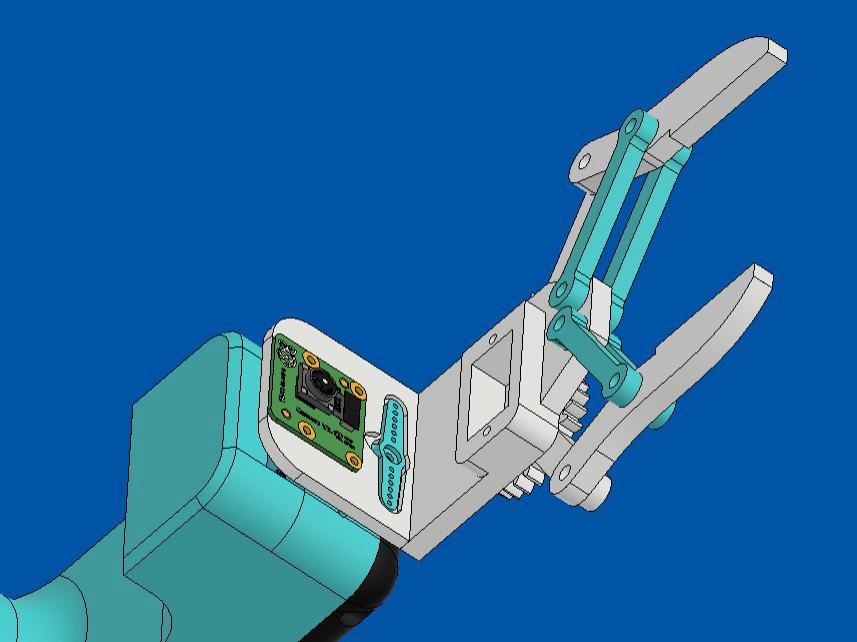 | 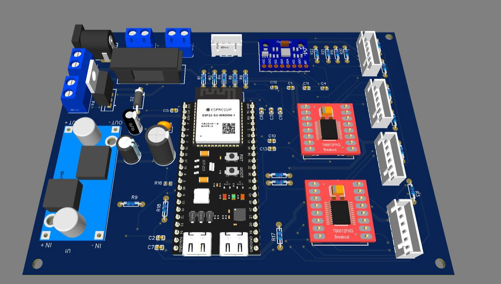 | 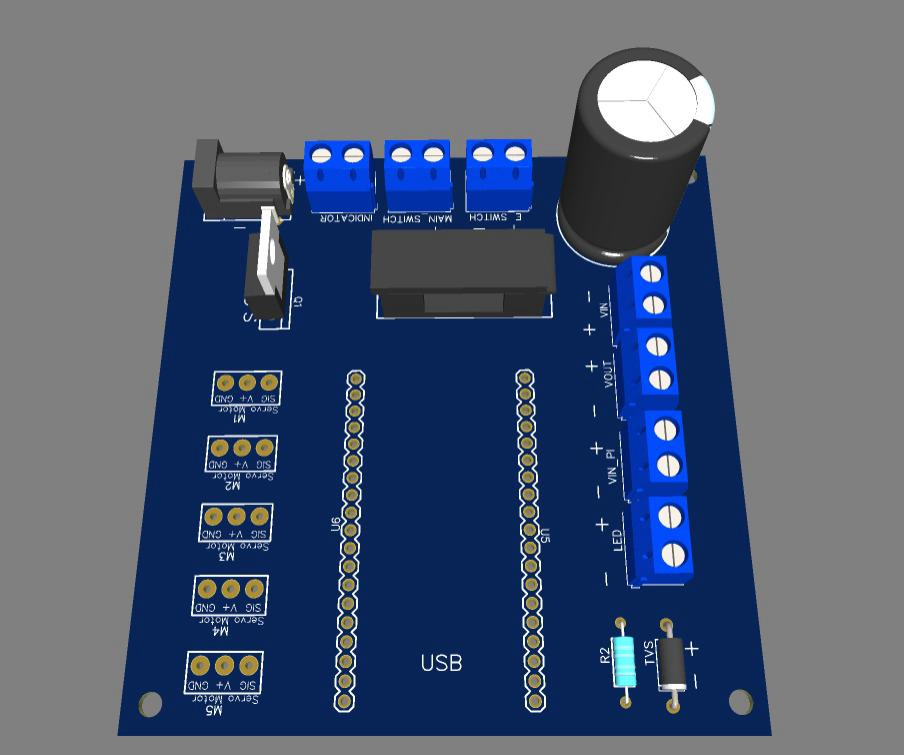 |

### System overview

| Subsystem | Controller | Actuators | Sensors |
|-----------|-----------|-----------|---------|
| Mobile base | ESP32-S3 (base PCB) | 4 x 25GA370 12 V DC gear motors with encoders, 2 x TB6612 dual motor drivers | MPU-6050 IMU, HC-SR04 ultrasonic, 8 encoder channels |
| Arm | ESP32-S3 (arm PCB) | 3 x MG996R and 2 x SG90 servos (5 joints/gripper) | MPU-6050 IMU, Raspberry Pi camera |
| Brain | Raspberry Pi | - | Camera (QR vision), PS4 controller input |

The Pi talks to each ESP32 over a serial (UART) link. See the Serial Command
Protocol section for the commands.

### Mobile base

- **Motors:** 25GA370 DC gear motor with encoder, 12 V, 250 rpm rated, stall
  torque about 0.38 N·m. Sizing assumptions: 5 kg vehicle, 50 mm wheels, 4
  wheels, 40 m/min target speed. That needs about 255 rpm and 0.087 N·m
  (safety factor 1.5), so the motor has roughly 4x torque margin at stall.
- **Drivers:** two TB6612 dual H-bridge drivers (motors 1-2 on U7, motors 3-4
  on U8), 20 kHz 8-bit PWM. STBY pins are tied to 3.3 V.
- **Encoders:** 8 channels (A/B per motor). Each input has a 10 kΩ pull-up,
  a 100 Ω series resistor and a 10 nF capacitor as a filter.
- **IMU:** MPU-6050 (GY-521) on I2C, SDA GPIO21, SCL GPIO8, address 0x68.
- **Ultrasonic:** HC-SR04, TRIG on GPIO14, ECHO on GPIO12 through a 1 kΩ / 2 kΩ
  divider (5 V to about 3.3 V).
- **Power path:** battery, 8 A fuse, IRF9540 P-channel MOSFET for
  reverse-polarity protection, main switch, E-STOP, then the 12 V rail. A buck
  converter makes 5 V for the ESP32, drivers' logic supply and the ultrasonic
  sensor. A P6KE15A TVS diode clamps the 12 V rail, with bulk and bypass
  capacitors on the 12 V, 5 V and 3.3 V rails.
- **Note on the E-STOP:** in the REV 5.0 schematic the E-STOP sits upstream of
  the buck converter, so it cuts motor power and ESP32 power together. The
  design documents list this behavior as an open decision.

Base ESP32-S3 pin map (REV 5.0):

| Function | GPIO |
|----------|------|
| Driver 1 (motors 1-2): PWMA, AIN1, AIN2, PWMB, BIN1, BIN2 | 4, 5, 6, 7, 15, 16 |
| Driver 2 (motors 3-4): PWMA, AIN1, AIN2, PWMB, BIN1, BIN2 | 18, 3, 9, 10, 11, 13 |
| Encoders ENC1 A/B, ENC2 A/B, ENC3 A/B, ENC4 A/B | 1/2, 35/36, 37/17, 38/47 |
| IMU SDA / SCL | 21 / 8 |
| Ultrasonic TRIG / ECHO | 14 / 12 |
| Strapping pins with pull resistors | GPIO0 (pull-up), GPIO45, GPIO46, GPIO3 (pull-downs) |

### Arm

- **Servos:** 3 x MG996R and 2 x SG90, all powered from a regulated 5 V rail,
  not from raw battery voltage.
- **Power path:** battery jack, reverse-polarity P-channel MOSFET, 5 A fuse,
  main switch, E-STOP, external XL4016 buck converter to 5 V. A P6KE6.8A TVS
  diode and a 1000 µF capacitor sit on the 5 V rail.
- **IMU:** MPU-6050 at address 0x68 (AD0 to GND) with the interrupt line on
  GPIO37.
- **Servo signal pins:** joints 1 and 2 on GPIO36 and GPIO35, gripper on
  GPIO21. The arm PCB REV 2.0 audit moves joints 3 and 4 off the strapping
  pins GPIO0 and GPIO45 to GPIO19 and GPIO20. The same audit lists
  schematic fixes (MOSFET orientation, IMU power and SCL wiring) that were
  required before PCB layout. Check the latest revision before building a
  board.

### Power budget

Each subsystem has its own battery to reduce electrical noise. Target runtime
is 30 minutes.

| | Rated current | Max current | Battery capacity (with 30% margin) | Fuse (1.25 x max) |
|---|---|---|---|---|
| Arm (servos, Pi, camera, ESP, IMU) | 3.5 A | 12.22 A | about 2.3 Ah, 3000-5000 mAh recommended | about 15 A in the sizing study |
| Mobile base (4 motors, ESP32, sensors) | 2.27 A | 7.74 A | about 1.5 Ah, 3000-5000 mAh recommended | about 10 A in the sizing study |

The sizing study recommends 18 AWG from battery to distribution, 20 AWG for
motors, 20-22 AWG for servos and 24 AWG for sensors. The fuses on the actual
PCB schematics are 8 A (base) and 5 A (arm).

A separate battery study for the five-servo arm module estimates 1.5 Ah
minimum for 20 minutes and suggests 18650 Li-ion cells in a 2S2P pack, which
meets the 5C peak-current requirement for servo stall.

### Wiring (original bench setup)

The wiring diagram below is from the original README and shows an
ESP32 with an L298N driver and the Pi-to-ESP32 UART link. The PCB design
above uses TB6612 drivers on an ESP32-S3.

```
Raspberry Pi                    ESP32
───────────────                 ────────────────
GPIO14 (TXD) ──────────────── RX2 (GPIO16)
GPIO15 (RXD) ──────────────── TX2 (GPIO17)
GND          ──────────────── GND

                ESP32           L298N Motor Driver
                ─────           ──────────────────
                GPIO25 ──────── IN1
                GPIO26 ──────── IN2
                GPIO27 ──────── ENA (PWM)
                GPIO14 ──────── IN3
                GPIO12 ──────── IN4
                GPIO13 ──────── ENB (PWM)
```

---

## Project Structure

```
pi-robot/
├── main.py                    # Entry point: starts all nodes
├── requirements.txt
├── config/
│   ├── config.yaml            # All tunable parameters
│   └── config_loader.py       # YAML loader + typed accessors
├── core/
│   ├── message_bus.py         # Pub/sub inter-node communication
│   ├── base_node.py           # Abstract base class for all nodes
│   └── pid_controller.py      # Generic PID controller
├── nodes/
│   ├── camera_node.py         # Camera capture
│   ├── camera_vision_node.py  # Camera + QR vision
│   ├── vision_node.py         # QR detection
│   ├── decision_node.py       # State machine + PID control
│   ├── command_node.py        # Action to serial command string
│   ├── serial_node.py         # UART bridge to ESP32
│   ├── ws_bridge_node.py      # WebSocket bridge
│   ├── dashboard_node.py      # Dashboard
│   ├── ps4_node.py            # PS4 manual control
│   ├── logger_node.py         # Activity audit log
│   └── manual_node.py         # Keyboard manual control
├── tests/                     # Unit tests
├── scripts/
│   └── test_binary_base.py    # Serial test script for the base
└── images/                    # CAD renders used in this README
```

---

## System Architecture

```
┌─────────────┐    CAMERA_FRAME    ┌─────────────┐
│ camera_node │ ─────────────────► │ vision_node │
└─────────────┘                    └──────┬──────┘
                                          │ QR_DETECTED / QR_LOST
                                          ▼
                                   ┌──────────────┐
            MANUAL_COMMAND ──────► │decision_node │ ◄── SERIAL_FEEDBACK
            SYSTEM_MODE   ──────►  │ (state mach.)│
                                   └──────┬───────┘
                                          │ DECISION_ACTION
                                          ▼
                                   ┌──────────────┐
                                   │ command_node │
                                   └──────┬───────┘
                                          │ COMMAND_SERIAL
                                          ▼
                                   ┌──────────────┐    UART     ┌────────┐
                                   │  serial_node │ ──────────► │ ESP32  │
                                   └──────────────┘ ◄────────── └────────┘
                                                       feedback
```

---

## State Machine (AUTO mode)

AUTO mode runs an 11-step odometry-driven sequence (see `decision_node.py`),
using the ESP32 base's closed-loop `BASE:GOTO` position controller and the
ARM's `SEQ` hardware sequences — not a fixed-duration drive or a
vision-guided search/align loop.

```
AUTO_RESET → AUTO_GOTO_1 → AUTO_ROTATE_CCW → AUTO_GOTO_2 → AUTO_PICK
  → AUTO_GOTO_3 → AUTO_PLACE_1 → AUTO_ROTATE_CW → AUTO_GOTO_4
  → AUTO_GOTO_5 → AUTO_PLACE_2 → AUTO_STOP → AUTO_DONE

         (any GOTO / ROTATE / SEQ step timing out → AUTO_ABORTED,
          which stops the base and arm safely)
```

| State | What happens |
|-------|-------------|
| AUTO_RESET | `BASE:POS:RESET` — zero odometry |
| AUTO_GOTO_* | `BASE:GOTO:<x>,<y>` — wait for `POS:REACHED` |
| AUTO_ROTATE_CCW / CW | `BASE:ROTATECCW` / `CW`, poll `BASE:POS?` until accumulated heading change reaches target, then `BASE:STOP` |
| AUTO_PICK | `SEQ 0` — wait for `SEQ_DONE 0` (pick RED cube) |
| AUTO_PLACE_1 / 2 | `SEQ 1` / `SEQ 2` — wait for matching `SEQ_DONE` |
| AUTO_STOP | Final `BASE:STOP` |
| AUTO_DONE | Sequence complete — stays here until switched back to MANUAL |
| AUTO_ABORTED | A step timed out or the ESP32 reported `SEQ_ABORTED` — base and arm already stopped safely |

QR-based color detection (`vision_node.py` → `VISION_QR_DETECTED`) still
feeds `_cube_color` for logging/dashboard display during MANUAL pick, but
the AUTO sequence itself does not search for or align to QR codes — it
follows fixed waypoints from the autonomous spec.

---

## Serial Command Protocol

Commands are newline-terminated strings sent from Pi → ESP32 (BASE) and a
separate ESP32 (ARM):

```
# BASE (esp_base.ino) — UART /dev/ttyACM0
BASE:FORWARD / BACKWARD / LEFT / RIGHT       Open-loop drive
BASE:ROTATECW / ROTATECCW / STOP             Open-loop rotate / stop
BASE:SPEED:<0-255>                           Global PWM duty
BASE:GOTO:<x>,<y>[,<tolerance>]              Closed-loop move to world (x,y) — returns POS:REACHED
BASE:GOTO:CANCEL                             Abort an in-progress GOTO
BASE:POS?                                    Query odometry — returns POS:<x>,<y>,<heading>,<totalDistance>
BASE:POS:RESET                               Zero odometry

# ARM (robot_arm_merged.ino) — Serial2 /dev/ttyUSB0
HOME / STOP / GRIPPER <deg> / JOINT <j> <deg>
SPEED <ms> / SEQ <0|1|2> / SEQ_STOP / SEQ_STATE
```

ESP32 feedback:
```
OK:<cmd>                          Command acknowledged (BASE)
ERR:<reason>                      Error (BASE or ARM)
POS:<x>,<y>,<heading>,<dist>      Pose stream / BASE:POS? reply
POS:REACHED:<x>,<y>               GOTO arrival
SEQ_STEP <n> box=<b> (<name>)     ARM sequence progress
SEQ_DONE <box>                    ARM sequence completed
SEQ_ABORTED / SEQ_IDLE            ARM sequence stopped / nothing running
```

### Autonomous SEQ box mapping

The Pi-side `decision_node.py` AUTO sequence uses the ESP32 ARM's `SEQ`
command with the following mapping:

| SEQ box | Action            |
|---------|--------------------|
| 0       | Pick RED cube      |
| 1       | Place — zone 1     |
| 2       | Place — zone 2 (final) |

This is also reflected in `command_node.py`'s high-level action map
(`ARM:PICK` → `SEQ 0`, `ARM:PLACE1` → `SEQ 1`, `ARM:PLACE2` → `SEQ 2`).

---

## Installation

### 1. Raspberry Pi Setup

```bash
# System dependencies
sudo apt-get update
sudo apt-get install -y python3-opencv python3-pip

# Enable UART
sudo raspi-config
# → Interface Options → Serial Port
# → Disable login shell over serial
# → Enable serial port hardware

# Add user to serial group
sudo usermod -a -G dialout $USER
# (log out and back in after this)

# Python dependencies
cd pi-robot/
pip install -r requirements.txt
```

### 2. Clone and configure

```bash
git clone https://github.com/mb4871787-creator/pi-robot.git
cd pi-robot

# Edit config to match your hardware
nano config/config.yaml
# Key settings:
#   serial.port       — your UART port (ls /dev/tty*)
#   camera.device_index — 0 for USB webcam, or use libcamera
```

### 3. Run

```bash
# AUTO mode (vision-guided)
python main.py

# MANUAL mode (keyboard control)
python main.py --mode manual

# Custom config
python main.py --config /path/to/config.yaml

# List all supported commands
python main.py --list-commands
```

---

## Manual Mode Key Bindings

| Key | Action |
|-----|--------|
| W   | Forward |
| S   | Backward |
| A   | Turn Left |
| D   | Turn Right |
| SPACE | Stop |
| Q   | Arm Home |
| E   | Arm Pick (full sequence) |
| Z   | Arm Lower |
| X   | Arm Raise |
| C   | Arm Grip |
| V   | Arm Place |
| M   | Toggle AUTO ↔ MANUAL |
| ESC | Emergency Stop + Quit |

---

## Configuration Reference

```yaml
serial:
  port: "/dev/ttyUSB0"      # UART device path
  baud_rate: 115200         # Must match ESP32 Serial.begin()

camera:
  device_index: 0           # USB webcam index
  frame_width: 640
  frame_height: 480
  fps: 30

vision:
  center_deadzone: 20       # pixels — alignment tolerance
  target_qr_size: 15000     # pixels² — "close enough" to pick
  min_qr_area: 500          # pixels² — minimum valid detection

pid:
  lateral:                  # Controls turning during ALIGN
    kp: 0.08
    ki: 0.001
    kd: 0.01
  distance:                 # Controls forward speed during MOVE
    kp: 0.003
    ki: 0.0001
    kd: 0.0005
```

### PID Tuning Guide

1. **Start with kp only** (ki=kd=0) — increase until robot responds
2. **Add kd** — reduces overshoot and oscillation
3. **Add ki last** — eliminates steady-state error
4. **center_deadzone** — increase if robot oscillates at target
5. **target_qr_size** — increase if robot stops too far away

---

## Running Tests

```bash
cd pi-robot/
python -m pytest tests/ -v
```

---

## Extending the System

### Add a new node

1. Create `nodes/my_new_node.py`
2. Inherit from `BaseNode`
3. Implement `setup()`, `run()`, `cleanup()`
4. Add new topic constants to `core/message_bus.py → Topics`
5. Register in `main.py → RobotController.build_nodes()`

### Add a new command

1. Add the command string format to the ESP32 firmware (not included in this repo)
2. Add handler in `nodes/command_node.py → _build_command()`
3. Add parser in ESP32 firmware `parseCommand()`

---

## Troubleshooting

| Issue | Solution |
|-------|----------|
| `Cannot open camera at index 0` | Check `ls /dev/video*`, try index 1 |
| `Serial open failed` | Check port with `ls /dev/tty*`, verify user in `dialout` group |
| Robot oscillates during ALIGN | Increase `center_deadzone` or reduce `pid.lateral.kp` |
| Robot overshoots during MOVE | Increase `pid.distance.kd` |
| QR detection unreliable | Improve lighting, adjust `min_qr_area` threshold |
| Runs in SIMULATION mode | pyserial not installed, or serial port not found |
